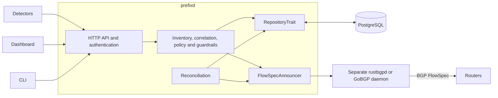

# Architecture

prefixd sits between attack detectors and a separate BGP speaker. It receives
signals, applies mitigation policy and guardrails, persists desired intent in
PostgreSQL, and asks the speaker to originate or withdraw FlowSpec rules. Routers
perform the filtering; prefixd does not inspect or scrub packets.

rustbgpd is the preferred integration target and GoBGP remains selectable.
Consult the [speaker reference](../reference/speaker-backends.md) for current
build requirements, configuration and deployment defaults, and the
[quickstart](../tutorials/quickstart.md) for the supplied stack.

## Overview

The supplied deployment uses nginx as the dashboard/API entrypoint. The diagram
shows logical calls, not an instruction to expose controller or speaker management
ports. See [deployment](../how-to/deployment.md) for transport and authentication.

## Design principles

### Signals and policy

Detectors supply attack events; inventory identifies owned addresses and customer
or service context. Optional multi-signal correlation groups events and applies
source-count and confidence thresholds before mitigation. Corroborating-only
sources can strengthen a group but cannot initiate mitigation alone.

Playbooks select the initial action and TTL. The current event path extends an
existing canonical owner's TTL rather than automatically executing later
escalation steps.

### Bounded mitigation intent

Automatic policy emits IPv4 `/32` or IPv6 `/128` destinations. Guardrails validate
configured prefix limits, TTL bounds, port counts, safelist protection, quotas and
the new mitigation rate before creating new intent. The manual API has its own
input validators and uses the shared guardrails. See [configuration](../reference/configuration.md#guardrails)
for the limits and [API reference](../reference/api.md#create-mitigation) for
manual input.

Every rule has an application expiry. The running controller performs expiry
cleanup; FlowSpec injection carries no controller lease. If prefixd stops while
the separate speaker remains up, advertisements can outlive their deadlines.
Recovering reconciliation and successful deletion are required for cleanup.
[ADR 003](../adr/003-fail-open-ttl.md) records this boundary.

### Separate routing runtime

Policy callers use the shared speaker traits; they do not branch between Rust
and Go implementations. Backend construction and protocol details belong to the
adapter. [ADR 023](../adr/023-rustbgpd-over-grpc.md) chooses a separate rustbgpd
daemon over gRPC rather than embedding its private runtime crates.
[ADR 025](../adr/025-pluggable-speaker-backends.md) defines backend capabilities;
ExaBGP and other daemon adapters remain planned until their recovery contracts
are implemented and qualified.

The controller remains Rust, axum, sqlx and PostgreSQL behind `RepositoryTrait`.
[ADR 026](../adr/026-facelift-framework-scope.md) defers the proposed Loco migration
throughout the facelift.

## Data flow

### Event ingestion and creation

1. HTTP middleware applies the shared request-body and rate limits. The handler
   authenticates and validates the event, including its timestamp, source, victim
   address, vector and supported action.
2. A previously stored ban with the same source and external event ID returns a
   duplicate conflict. A distinct event may extend an existing canonical owner;
   these are different operations.
3. Inventory, optional correlation and the first matching playbook determine
   whether mitigation is eligible. An accepted event can produce no mitigation,
   for example for an unowned address or an unmet correlation threshold.
4. New intent passes guardrails. With the controller lifecycle mutex held, it is
   persisted as Active desired state **before** the speaker mutation. Dry-run
   skips the mutation.
5. In enforced mode the shared writer attempts the announcement. An uncertain or
   failed RPC retains desired intent and returns an unconfirmed outcome for
   readable reconciliation. It does not mean the speaker rejected the rule.

Active status and creation notifications describe controller intent. Successful
RPC acceptance, local read-back, export, peer receipt and forwarding enforcement
are separate observations. Neither a creation response nor a healthy BGP session
proves that a router is applying the rule.

### Withdrawal and expiry

Detector unban looks up the original ban by source and external event ID, then
its active mitigation. Operator single/bulk withdrawal and TTL expiry share the
same durable deletion path:

1. Validate the current canonical owner and immutable speaker binding.
2. Persist an immutable withdrawal request containing the original rule, target,
   actor, reason, operation ID and whether real deletion is required.
3. Attempt deletion on that target. Failure or ambiguity leaves cleanup pending
   and prevents reconciliation from reannouncing its rule.
4. After local deletion succeeds, commit the terminal mitigation status,
   original-actor audit and operation completion atomically. If that commit fails,
   the persisted request remains retryable.

Enforced-mode requests remain pending in dry-run; changing modes does not supply
remote deletion acknowledgement. Each mitigation records the mode that admitted
it. A dry-run mitigation's withdrawal never requires real deletion, and
reconciliation never announces it; enforced startup refuses unexpired dry-run
intent until it is retired locally. Unknown or foreign-POP rules are never removed
as a substitute for ownership checks. See the
[withdrawal implementation](../../src/domain/withdrawal.rs) and
[recovery semantics](../reference/speaker-backends.md#withdrawal-recovery).

### Reconciliation

Reconciliation runs at startup and at the configured interval. Pending
withdrawal/expiry cleanup, correlation housekeeping, announcement repair and peer
observation are independent stages.

Repair requires complete eligible POP intent and a successful complete local
read. An observation error is not an empty RIB; an unsupported reader skips
repair. Expired intent, pending creation and pending withdrawals cannot authorize
fresh announcements. Each mutation rechecks current ownership and pending intent
under the controller mutex. That mutex is released between rules and does not
fence another controller process; the advisory-lock fence under
[Multi-POP ownership](#multi-pop-ownership) does.

Missing local rules and supported action differences can be repaired under the
single-controller, exclusive-target contract. Unknown local rules are preserved;
recovery has no fixed deadline.
See the [scheduler](../../src/scheduler/reconcile.rs) and
[backend reference](../reference/speaker-backends.md#rule-and-reconciliation-semantics).

## Component details

### Policy and FlowSpec representation

Playbooks map a vector to an initial discard or police action and TTL.

For UDP/TCP floods, policy computes equality-port matches from event ports and
service `allowed_ports`. Disjoint explicit nonempty lists are rejected with
`422` / `NoAllowedPorts` before mitigation creation or owner TTL extension. An
unconstrained side uses the other side's ports; deliberately unconstrained inputs
retain no destination-port restriction. This is intersection, not a negated
exclusion rule. Automatic ICMP uses protocol 1 for IPv4 and 58 for IPv6; the manual
API's `icmp` selector currently means protocol 1.

`FlowSpecRule` contains destination prefix, optional protocol, destination-port
equalities and discard or traffic policing. Policy rates use bits/sec; adapters
handle wire-unit conversion and reject unsupported representations. See the
[domain types](../../src/domain/flowspec.rs) and backend reference for exact limits.

### Speaker interface

| Interface | Responsibility |
| --- | --- |
| `FlowSpecWriter` | Required announce/upsert and idempotent withdrawal |
| `FlowSpecReader` | Optional complete local-rule inventory |
| `PeerObserver` | Optional session-state observation |
| `FlowSpecAnnouncer` | Selected facade and capability accessors |

rustbgpd reads retained local injection intent. GoBGP reads its accepted local
RIB after import policy. Neither view proves export or enforcement. Unsupported
observation, failed observation and a successful empty result remain distinct.
The legacy health component name `gobgp` does not select the backend.

Additional adapters must define safe recovery for their available observations;
see the [trait](../../src/bgp/announcer.rs) and backend reference.

## State management

### PostgreSQL

The [migrations](../../migrations/) are the schema authority:

| State | Purpose |
| --- | --- |
| `events` | Detector history and source/external-ID deduplication |
| `mitigations` | Desired match, action, expiry, POP and lifecycle status |
| `withdrawal_requests` | Immutable pending and completed deletion operations |
| `speaker_targets`, `speaker_pop_bindings` | Registered target identity and exclusive POP assignment |
| `flowspec_announcements` | Existing announcement schema; not a complete runtime acknowledgement ledger |
| Signal groups and their event links | Correlation history and contributing sources |
| `audit_log` | Attributed operation history |
| Safelist, operators, sessions and preferences | Protection and operator access/state |

Database retention must preserve pending cleanup and referenced history. Use the
[documented retention transaction](../how-to/troubleshooting.md#database-growth),
not unscoped deletion of terminal rows.

### Multi-POP ownership

Controllers may share PostgreSQL for visibility, but each POP binds to one
normalized backend/endpoint/routing-namespace identity and each registered target
belongs to at most one POP. Run one controller per POP and use its physical
speaker exclusively. Cross-POP list/statistics access does not authorize another
POP's mutations or provide operation through a database outage.

Startup validates the registered target before connecting to the speaker.
Credential rotation preserves target identity; pending withdrawals retain the
original target even if configuration changes. Registration does not provide an
interprocess lease or recognize DNS aliases.

Before connecting to the speaker, each controller takes a PostgreSQL session
advisory lock keyed on its POP and target owner
([ADR 027](../adr/027-blackhole-mitigations.md)). Without it, the controller
stays in standby and mutates nothing, so a second controller sharing the
database cannot write to the speaker. The lock cannot see a controller using
another database or another tool writing to the same physical speaker. See
[controller fence and rolling deploys](../how-to/upgrading.md#controller-fence-and-rolling-deploys).

## Security model

Authentication is selected by deployment mode:

- `credentials`: PostgreSQL-backed operator sessions with viewer/operator/admin
  role checks. Session cookies are HttpOnly and SameSite=Lax; Secure is enabled
  when native HTTP TLS is configured. Session expiry is based on inactivity.
- `bearer`: the configured token provides operator-level API access; existing
  authenticated sessions retain their own roles.
- `mtls`: startup requires native TLS with client verification; accepted clients
  receive the current administrative trust level, not per-certificate roles.
- `none`: bypasses authentication and role checks for development/test use.

The WebSocket feed requires a browser session unless auth is disabled; a bearer
token is not a WebSocket login. Account/session and protected handlers enforce
their own requirements. Unauthenticated liveness, metrics and OpenAPI handlers do
not imply access to operational health or mutations. Metrics remain on the
private API listener and are blocked at the default public proxies. Configuration
exposure uses an explicit safe-field allowlist and separate secret redaction.

Ingress, PostgreSQL and speaker management access are separate trust boundaries.
Use authenticated private management transport and review HTTPS/cookie settings
at the actual ingress. See [API authentication](../reference/api.md#authentication),
[deployment](../how-to/deployment.md) and [auth implementation](../../src/api/auth.rs).

## Failure modes

| Failure | Current behavior and limit |
| --- | --- |
| Controller stops | No new decisions or TTL cleanup; the independent speaker can retain advertisements. |
| PostgreSQL unavailable | Persistence/ownership reads and dependent requests fail; cleanup and repair cannot safely proceed without their required state. |
| Speaker unavailable or reply lost | Persisted desired intent or deletion intent remains; outcomes are uncertain until successfully observed/retried on the same target. |
| Router/session loss | Delivery depends on speaker/router policy, reconnection and restart-retention settings; prefixd health cannot prove forwarding recovery. |

A database restore does not undo speaker mutations. Preserve pending intent,
speaker ownership and audit history during recovery.

## Evidence and limits

The shipped [backend checks](../reference/speaker-backends.md#readable-backend-qualification)
exercise local RPCs, restart and peer receipt within their stated scope; they do
not establish vendor forwarding or every production topology.
[Historical benchmarks](../perf/benchmarks.md) retain their original test context,
not a current capacity or recovery-time guarantee.
